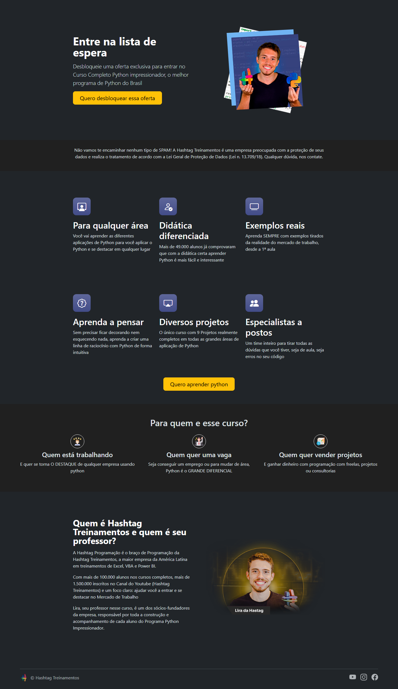
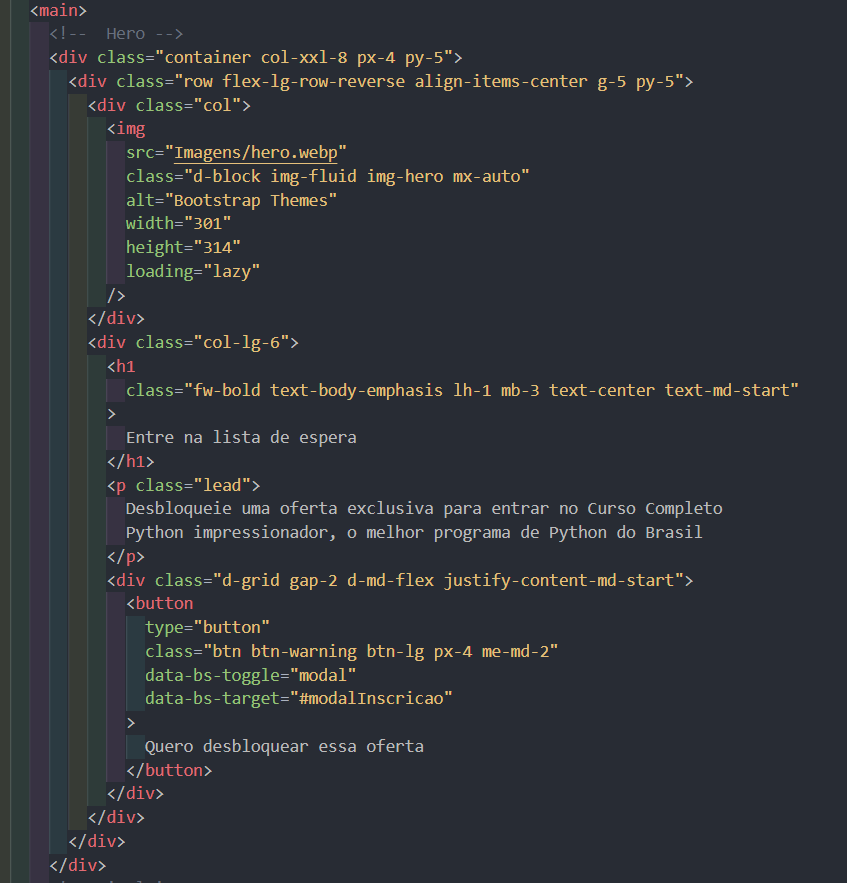
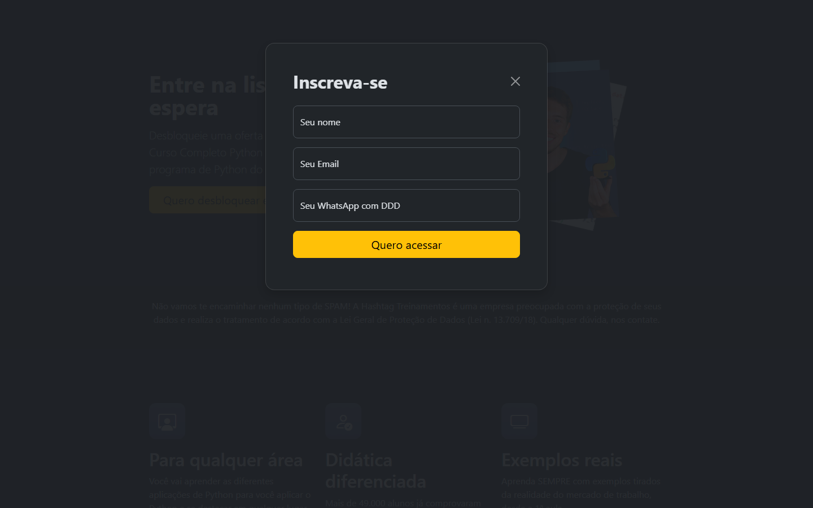

# Landing Page – Lista de Espera (Bootstrap 5)

Landing page simples de captura de leads para a lista de espera do curso **Python Impressionador**, construída quase inteiramente com classes utilitárias e componentes do **Bootstrap 5.3**.



## Tecnologias

| Tecnologia | Uso |
| --- | --- |
| HTML5 | Estrutura da página |
| [Bootstrap 5.3.3](https://getbootstrap.com/) (CDN) | Grid, utilitários, botões, formulário e modal |
| [Bootstrap Icons 1.11.3](https://icons.getbootstrap.com/) (CDN) | Ícones dos cards de features |
| CSS próprio ([style.css](style.css)) | Ajustes pontuais (cores de seção, tamanho dos ícones e imagens) |

Nenhum build ou instalação é necessário: basta abrir o `index.html` no navegador.

## Estrutura

```
├── index.html      # página
├── style.css       # CSS próprio
├── Imagens/        # imagens e ícones
└── screenshots/    # prints usados neste README
```

## HTML construído com classes Bootstrap

Trecho do HTML da seção Hero. Quase toda a estilização vem das classes do Bootstrap aplicadas direto nos elementos. A única classe própria é `img-hero`, que define a largura da imagem no `style.css`:



## Como o Bootstrap foi usado

### Inclusão via CDN e tema escuro

O tema escuro é ativado apenas com o atributo `data-bs-theme="dark"` na tag `<html>`:

```html
<html lang="en" data-bs-theme="dark">
  <head>
    <link href="https://cdn.jsdelivr.net/npm/bootstrap@5.3.3/dist/css/bootstrap.min.css" rel="stylesheet" />
    <link rel="stylesheet" href="https://cdn.jsdelivr.net/npm/bootstrap-icons@1.11.3/font/bootstrap-icons.min.css" />
    <link rel="stylesheet" href="style.css" />
  </head>
  ...
  <script src="https://cdn.jsdelivr.net/npm/bootstrap@5.3.3/dist/js/bootstrap.min.js"></script>
</html>
```

### Hero (grid responsivo)

```html
<div class="container col-xxl-8 px-4 py-5">
  <div class="row flex-lg-row-reverse align-items-center g-5 py-5">
    <div class="col">
      
    </div>
    <div class="col-lg-6">
      <h1 class="fw-bold text-body-emphasis lh-1 mb-3 text-center text-md-start">Entre na lista de espera</h1>
      <p class="lead">...</p>
      <div class="d-grid gap-2 d-md-flex justify-content-md-start">
        <button class="btn btn-warning btn-lg px-4 me-md-2"
                data-bs-toggle="modal" data-bs-target="#modalInscricao">
          Quero desbloquear essa oferta
        </button>
      </div>
    </div>
  </div>
</div>
```

- `row` / `col` / `col-lg-6`: grid de 12 colunas.
- `flex-lg-row-reverse`: no desktop a imagem fica à direita; no celular ela aparece primeiro.
- `text-center text-md-start`: título centralizado no celular e alinhado à esquerda a partir de telas médias.
- `d-grid` → `d-md-flex`: botão ocupa a largura toda no celular.

### Features (cards com ícones)

```html
<div class="row g-4 py-5 row-cols-1 row-cols-lg-3">
  <div class="feature col">
    <div class="feature-icon d-inline-flex align-items-center justify-content-center text-bg-primary bg-gradient fs-2 mb-3">
      <i class="bi-person-workspace"></i>
    </div>
    <h3 class="fs-2 text-body-emphasis">Para qualquer área</h3>
    <p>...</p>
  </div>
  ...
</div>
```

- `row-cols-1 row-cols-lg-3`: 1 card por linha no celular, 3 no desktop.
- `bi-*`: ícones do Bootstrap Icons.
- `text-bg-primary bg-gradient`: fundo do ícone (a cor primária é sobrescrita no `style.css` com `--bs-primary-rgb`).

### "Para quem é esse curso?"

```html
<div class="row row-cols-1 row-cols-sm-2 row-cols-md-3 mt-4">
  <div class="col">
    <div class="para-quem__icone p-2 mx-auto mb-2 border border-white rounded-circle">
      
    </div>
    <h3 class="h4">Quem está trabalhando</h3>
  </div>
  ...
</div>
```

- `border border-white rounded-circle`: moldura circular dos ícones.
- `row-cols-sm-2 row-cols-md-3`: 1, 2 ou 3 colunas conforme o tamanho da tela.

### Footer

```html
<footer class="d-flex flex-wrap justify-content-between align-items-center py-3 my-4 border-top">
  <div class="col-md-4 d-flex align-items-center">...</div>
  <ul class="nav col-md-4 justify-content-end list-unstyled d-flex">...</ul>
</footer>
```

### Modal de inscrição

Os botões com `data-bs-toggle="modal"` e `data-bs-target="#modalInscricao"` abrem o modal sem nenhuma linha de JavaScript própria — o `bootstrap.min.js` cuida disso.



```html
<div class="modal modal-sheet bg-body p-4 py-md-5" id="modalInscricao" tabindex="-1">
  <div class="modal-dialog">
    <div class="modal-content rounded-4 shadow">
      <div class="modal-header p-5 pb-4 border-bottom-0">
        <h2 class="fw-bold mb-0 fs-2">Inscreva-se</h2>
        <button class="btn-close" data-bs-dismiss="modal"></button>
      </div>
      <div class="modal-body p-5 pt-0">
        <form>
          <div class="form-floating mb-3">
            <input type="text" class="form-control rounded-3" id="inputNome" placeholder="João da Silva" />
            <label for="inputNome">Seu nome</label>
          </div>
          ...
          <button class="w-100 mb-2 btn btn-lg rounded-3 btn-warning" type="submit">Quero acessar</button>
        </form>
      </div>
    </div>
  </div>
</div>
```

- `form-floating`: label flutuante dentro do campo.
- `btn-close` + `data-bs-dismiss="modal"`: botão de fechar.
- `w-100`: botão com largura total.

## Resumo das principais classes

| Categoria | Classes |
| --- | --- |
| Layout / Grid | `container`, `container-fluid`, `row`, `col`, `col-lg-6`, `row-cols-*`, `g-4`, `g-5` |
| Flexbox | `d-flex`, `d-grid`, `d-md-flex`, `flex-wrap`, `flex-lg-row-reverse`, `align-items-center`, `justify-content-*` |
| Espaçamento | `p-*`, `px-*`, `py-*`, `m-*`, `mb-*`, `mt-*`, `mx-auto`, `me-md-2` |
| Tipografia | `fw-bold`, `fs-2`, `lead`, `lh-1`, `h4`, `text-center`, `text-md-start`, `text-body-emphasis`, `text-body-secondary` |
| Imagens | `img-fluid`, `d-block` |
| Bordas / Sombras | `border`, `border-top`, `border-white`, `rounded-circle`, `rounded-3`, `rounded-4`, `shadow` |
| Componentes | `btn`, `btn-warning`, `btn-lg`, `btn-close`, `modal`, `modal-dialog`, `modal-content`, `form-floating`, `form-control`, `nav` |

## Como executar

1. Clone o repositório.
2. Abra o `index.html` no navegador (ou use a extensão *Live Server* do VS Code).
